 

<a href="#about">About</a> · <a href="#tech-stack">Stack</a> · <a href="#featured-projects">Projects</a> · <a href="#github-activity">Activity</a> · <a href="#exploring">Exploring</a> · <a href="#connect">Connect</a>

 

I'm a software engineer in Nairobi who builds **full-stack web applications, REST APIs, and automation workflows**. I like turning scattered manual processes and half-working tools into reliable systems that people can actually use, from the database and API layer to a responsive interface.

---

## About me

- **Full-stack web development.** React on the front end, Node.js/Express or PHP on the back end, with MySQL, PostgreSQL, or MongoDB underneath.
- **APIs.** I design, build, and integrate REST APIs, and connect third-party services into working applications.
- **Automation.** I build workflows with n8n and use AI tools to speed up development and remove repetitive work.
- **Practical foundations.** Git, Linux, and a background in ICT support, networking, and computer maintenance keep my work grounded in how systems behave in the real world.
- **Always learning.** I pick up new tools by building something with them and shipping it.

---

## Tech stack

| | |
|:--|:--|
| **Frontend** |       |
| **Backend** |      |
| **Databases** |    |
| **AI & automation** |    |
| **Tools & platforms** |        |

---

## Featured projects

<table>
  <tr>
    <td width="50%" valign="top">
      <h3>🛍️ RummageBazaar</h3>
      
A full-stack marketplace where people can sell or donate pre-owned items. It includes Clerk-based authentication, a personal dashboard for managing listings, a mark-as-sold flow, a donation mode for free items, and an admin dashboard.

      
<b>Stack:</b> React · Vite · Tailwind CSS · Node.js · Express · MongoDB · Clerk · Render

      
<a href="https://github.com/8WAHOME/RummageBazaar">Repository</a> · <a href="https://rummagebazaar-1.onrender.com">Live site</a>

    </td>
    <td width="50%" valign="top">
      <h3>🌐 Goaltract</h3>
      <!-- TODO: add a one-line description, the tech stack, and a repository link if public -->
      
A live website I developed.

      
<a href="https://www.goaltract.com">goaltract.com</a>

    </td>
  </tr>
  <tr>
    <td width="50%" valign="top">
      <h3>🌐 RecoveryTrails</h3>
      <!-- TODO: verify the URL, then add a one-line description, the tech stack, and a repository link if public -->
      
A live website I developed.

      
<a href="https://recoverytrails.org">recoverytrails.org</a>

    </td>
    <td width="50%" valign="top">
      <h3>📂 More on GitHub</h3>
      

        <a href="https://github.com/8WAHOME/LaFoodie">LaFoodie</a>: food delivery company project (CSS) 
        <a href="https://github.com/8WAHOME/Carpentry-">Carpentry-</a>: PHP project 
        <a href="https://github.com/8WAHOME/MyPortfolio">MyPortfolio</a>: personal portfolio (HTML)
      

      
<a href="https://github.com/8WAHOME?tab=repositories">All repositories →</a>

    </td>
  </tr>
</table>

---

## GitHub activity

<table>
  <tr>
    <td width="50%" align="center">
      
    </td>
    <td width="50%" align="center">
      
    </td>
  </tr>
</table>

Cards are generated by third-party services. If one doesn't load, <a href="https://github.com/8WAHOME">my profile</a> shows the live numbers.

---

## Currently exploring

- **AI-assisted development.** Using generative AI to prototype faster, then reviewing and hardening what it produces.
- **Workflow automation.** Building more n8n workflows that connect APIs and remove manual steps.
- **API integrations.** Wiring third-party services into web apps cleanly and securely.

---

## Connect with me

<!-- Add once you confirm the URLs / address you want public:

-->

New Leaf | New Life

